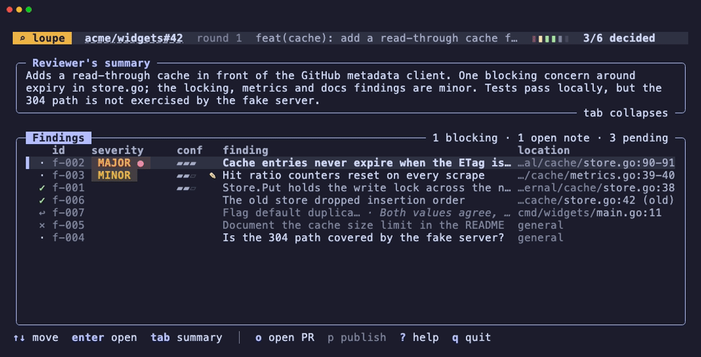
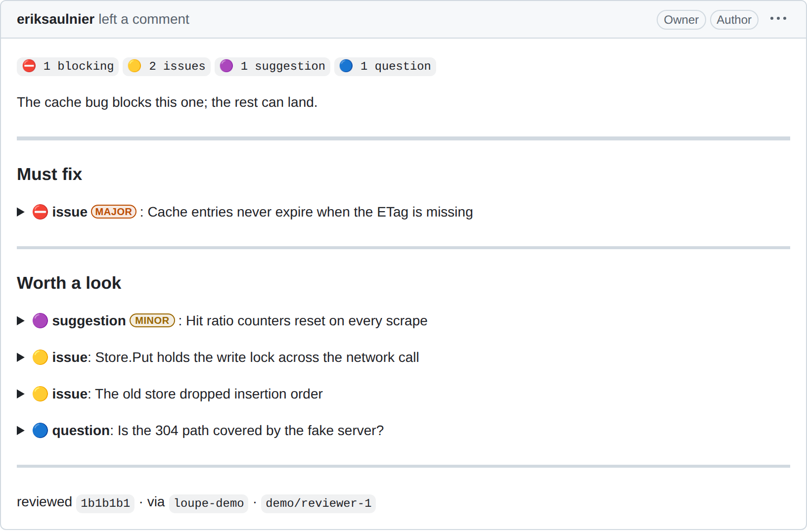

<picture>
  <source media="(prefers-color-scheme: dark)" srcset="docs/assets/logo-dark.png">
  
</picture>

[](https://github.com/secondshift-labs/loupe/releases/latest) [](https://github.com/secondshift-labs/loupe/actions/workflows/ci.yml) [](https://codecov.io/gh/secondshift-labs/loupe)

loupe collects a review agent's findings into a local draft so you decide each one and publish a single GitHub review. For local work, such as uncommitted changes or a plan, you decide the findings the same way and return the decisions to the agent that applies them.



## Why loupe

- **Nothing posts under your name unread.** You accept, rewrite or drop each finding yourself. You write the review's opening, and one confirmation sends one review.
- **Any review agent works.** loupe has no opinion on how findings are found. The agent files them through a CLI, and a plugin for Claude Code, Codex and Pi teaches it the workflow.
- **Findings are files on disk.** One directory per run. No daemon, no database, no service to sign up for.
- **Human and bot reviews read the same.** A CI job can publish through loupe too. Its review uses the same comment format. It is marked unattended and never approves or blocks a merge.

## How it works

1. Your agent captures the pull request into a run and files its findings into the draft.
2. You decide each finding in `loupe review`, which opens in a pane beside the agent in Herdr, tmux, Orca, iTerm2 or Ghostty. You accept, rewrite or drop each one, or send it back with a note for the agent to answer.
3. `loupe publish` shows the review as it will read, with its exact Markdown one key away. You write its opening, and one key posts it.

Local work, such as uncommitted changes, a plan or a spec, goes through the same review with no pull request. The agent captures it with `loupe capture --changed` or `--files`, and each finding shows the change the agent will make. Once you have decided the last one, you return the run, and the agent applies what you accepted. Nothing reaches GitHub. [Local work](docs/review-workflow.md#local-work) has the steps.

<picture>
  <source media="(prefers-color-scheme: dark)" srcset="docs/assets/review-dark.png">
  
</picture>

This is what a published review looks like. A CI review uses the same format.

`loupe stats` totals your decisions across runs: how many findings the agent filed, how many you published and how many you rejected.

## Install

One command installs the binary into `~/.local/bin`, checked against the release's checksum. It also installs the agent plugin, at the same release, into each of Claude Code, Codex and Pi that it finds.

```sh
curl -fsSL https://secondshift-labs.github.io/loupe/install.sh | sh
```

`loupe update` updates the binary and the plugins together, and `loupe uninstall` removes both and keeps your review runs. [Install](docs/install.md) covers the options, mise, release archives and GitHub Actions.

loupe runs on Linux and macOS, on amd64 and arm64, and needs `git`. It reaches GitHub with the token in `GH_TOKEN` or `GITHUB_TOKEN`, or else the one `gh auth login` stored, so a signed-in `gh` needs no setup.

To try the interface without a pull request, run `mise run demo` in a clone. It opens `loupe review` on seeded runs against an in-memory GitHub, so nothing leaves the machine.

## Documentation

- [Install](docs/install.md): the binary, the agent plugin for each host, and updating or removing the two together.
- [Comment format](docs/comment-format.md): the full reference for a published review, for anyone building on it.
- [The review workflow](docs/review-workflow.md): the attended loop, local work, the pane hand-off, adapting a review skill you already have, and the command and environment reference.
- [Unattended reviews in CI](docs/ci-action.md): the GitHub Action, the pipeline steps, sticky rounds and the rules an unattended review follows.
- [Withdrawal reasons](docs/reason-codes.md): how an agent says why it withdrew a finding, and the recommended reason codes.
- [CLI contract](specs/001-loupe-v1/contracts/cli.md): commands, input, results and errors, for scripting against loupe.
- [Constitution](.specify/memory/constitution.md): the seven principles every change answers to.
- [Contributing](CONTRIBUTING.md): setup, local development, tests, commits and releases.
- [Security](SECURITY.md): how to report a vulnerability.

## License

MIT. See [LICENSE](LICENSE).
