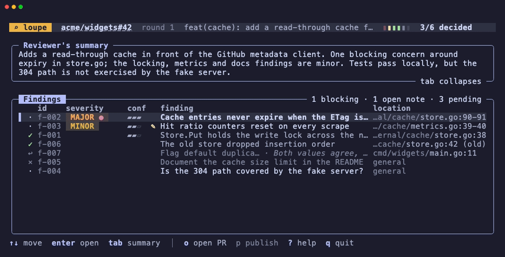
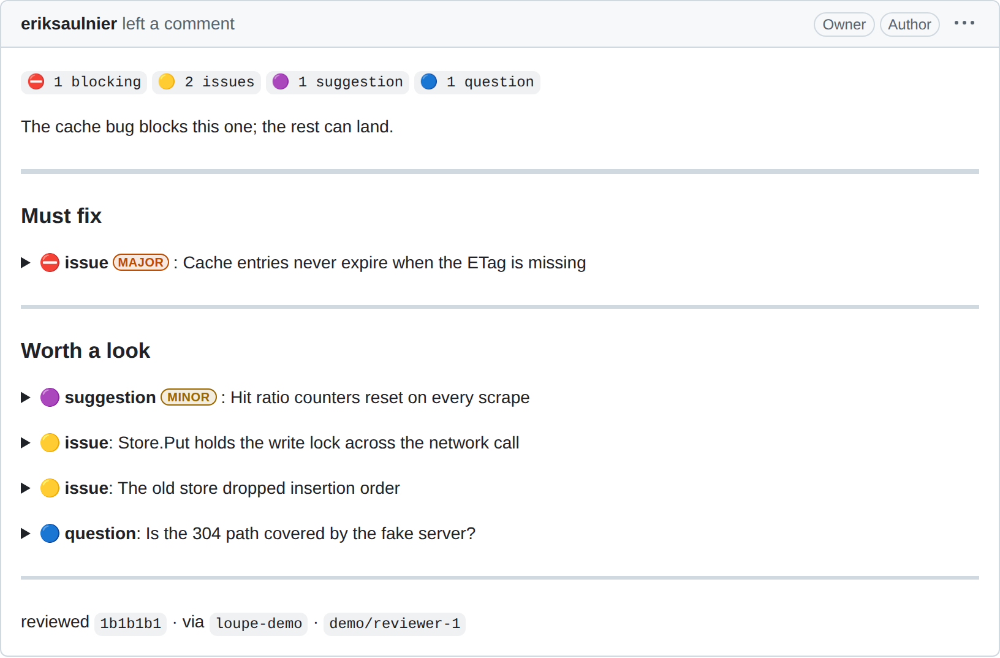

# The review workflow

A review with loupe is a loop between your agent and you. The agent does the review and files what it found. You decide each finding, and you publish. The agent never publishes.

This page assumes the binary and the agent plugin are installed. See [Install](install.md).

## The loop

### 1. The agent captures the pull request

Ask your agent to review a pull request. Its first step is `loupe capture <pr-url>`, run from a clone of the repository. Capture makes a run: a local draft of one review round, named like `owner/repo#123@1`. It pins the head commit and the diff that the review reads.

Capture writes Git objects and private refs into your clone. It never changes your working files, your index or your branch.

When an earlier round was published, capture reads its findings back. It also reads what other reviewers left on the pull request. The agent gets both, so it re-raises what is still open and does not repeat what someone already said.

### 2. The agent files findings and a summary

The agent files findings with `loupe add`. Each finding has a title and a Markdown body. It points at a line of the captured diff, or it is general. A location outside the captured diff is refused, and the refusal lists the nearest valid lines. Optional fields carry a label, a severity, whether the finding blocks, and how the agent knows.

The agent then sets a summary with `loupe summary`. The summary is for you. It says what the round looked at and what it could not check. It is not published.

### 3. The agent hands the run to you

`loupe handoff` opens `loupe review` in a new pane beside the agent's. See [Handing off in a terminal pane](#handing-off-in-a-terminal-pane). Without a supported terminal host, or when opening the pane fails, the agent asks you to run `loupe review` yourself. The agent then waits.

### 4. You decide each finding

`loupe review` lists the summary, the readiness counts and every finding. Opening a finding shows its body above the diff hunk it points at.

| Key | What it does |
| :--- | :--- |
| `a` | Accept the finding |
| `x` | Exclude the finding |
| `s` | Send the finding back to the agent with a note |
| `e` | Change the finding's label or whether it blocks |
| `w` | Rewrite the finding's title and body; `ctrl+s` saves and keeps the decision |
| `u` | Restore an excluded finding to pending, or reinstate and accept a withdrawn one |
| `r`, `d` | Resolve or dismiss the finding's open note |
| `f` | Show the whole file's diff |
| `o` | Open the pull request in the browser |
| `?` | List the keys for the current view |

`←` and `→` open the previous and next finding, as do `[` and `]`, and `n` opens the next. A letter works in either case outside a text input, so caps lock changes nothing.

On a local run, which the agent captured with `loupe capture --changed`, `--files` or `--no-files`, a finding can carry a proposal: the change the agent makes if you accept it. A finding with no proposal is a question. The header carries a `local · returns to <applier>` badge, so the run never reads as a pull request review. Review opens on a start screen with the summary and the number of findings to decide, `enter` starts at the first pending one, and each decision opens the next pending one. The keys there are these:

| Key | What it does |
| :--- | :--- |
| `a` | Accept the finding |
| `t` | Tweak: accept the finding with a note for the agent; an empty note is a plain accept |
| `x` | Reject the finding, with no reason |
| `c` | Reject the finding with a reason; an empty reason is a plain reject |
| `s` | Ask: send the finding back to the agent with a question |
| `u` | Restore an excluded finding to pending, or reinstate and accept a withdrawn one |
| `r`, `d` | Resolve or dismiss the finding's open note |
| `f` | Show the whole file's diff; a `--files` run shows the file as plain text |
| `enter` | On the start screen, start at the first pending finding; in the list, open the finding |
| `l` | Back to the list, as `esc` is, and from the start screen |
| `j`, `k`, `n`, `[`, `]`, `space`, `PgUp`, `PgDn`, `ctrl+r`, `esc` | Move, scroll, reload and go back, as on a pull request run |
| `p` | In the list, return the decisions to the agent, with an optional closing note; `enter` returns |
| `?` | List the keys for the current view |

`w`, `e` and `o` are absent, and there is no publish step.

Every decision is saved at once. The interface draws full screen, so `TERM=dumb` or a terminal that cannot enter raw mode refuses with `tty`. A window smaller than 60 by 12 shows its size until it grows.

On a pull request run, while review is open, it reads the pull request from GitHub as it opens and 60 seconds after each check. The header tags a pull request that merged, closed or gained commits since capture with `PR merged`, `PR closed` or `head moved`, and the first time each shows, one notice says so. With no network or credentials the tag reads `state unknown`, and review works as before. A run captured with `--allow-closed` is not tagged for being closed.

### 5. The agent answers what you send back

A note asks the agent about one finding. The agent revises the finding or withdraws it, then replies to your note. A withdrawn finding shows the agent's reason beside it, so you can judge the withdrawal before you reinstate it with `u`. You resolve or dismiss the note, and only then does the finding count as decided. A revised finding comes back pending, so you decide it again.



### 6. You publish

When no finding is pending and no note is open, press `p` in `loupe review`, or run `loupe publish`. The confirmation opens on the review as it reads, with every section open and each inline comment. `v` steps to its exact Markdown, then to the request payload.

The cursor starts in the review's opening. Type it in your own words and press Esc to leave it. Then `y` or `p` sends. `n`, `q` or `ctrl+c` cancels, and nothing is sent. Keys that scroll or switch views do nothing else, and any other key only says which keys answer.

Only accepted findings are published. One confirmation sends exactly one GitHub request. `--action` picks `comment`, `approve` or `request-changes`. `--inline` also turns located findings into inline comments.

<picture>
  <source media="(prefers-color-scheme: dark)" srcset="assets/review-dark.png">
  
</picture>

[Comment format](comment-format.md) describes every part of that review.

Publish refuses rather than send something wrong. Each refusal names the command that fixes it. It refuses:

- while a finding is pending or a note is open.
- when the captured commit has left the pull request's history.
- to approve or request changes on your own pull request.

A head that only gained commits since capture is not refused, for any action. The confirmation lists the new commits, how many files and lines they change, and the findings on files they changed. For an approval, a red line says that it covers the new commits unreviewed and that branch rules may not count it. A pull request that merged or closed after capture is named in the confirmation, and `y` still sends the review.

Once the review is posted, the run keeps a receipt. Running `loupe publish` again prints the review's URL without contacting GitHub.

## Later rounds

After the author pushes, ask the agent for another round. Capture makes a new run, such as `owner/repo#123@2`, and hands the agent the findings you published last time.

`loupe publish --sticky` keeps one review per pull request current. The first sticky round posts a review. Each later one replaces that review's body, with the new round on top and earlier rounds collapsed below it. The confirmation shows the whole new body and names the review it edits. An edit sends no notification.

The `p` key in `loupe review` always posts a new review, so a sticky round goes through `loupe publish`. A plain review posted after a sticky one ends the series, and the next sticky round starts a new review.

## Local work

The same loop works on local work: uncommitted changes, a plan or a spec, with no pull request and no GitHub. The agent follows the plugin's `human-decide` skill instead of `human-review`.

1. The agent captures the work with `loupe capture --changed`, `--files <path>` or `--no-files --title <title>`. That makes a local run, such as `owner/repo:local#7`, and no network call. `--changed` reads your staged, unstaged and untracked changes through a temporary index, so your own index, branch and files stay as they were. It runs none of your Git filters. So when you edit a file that Git converts on checkout, through CRLF line endings, a filter such as git-lfs, or `ident`, `--changed` cannot tell your edit from the conversion. It refuses, and `--files` captures those files instead. An untouched git-lfs or git-crypt file does not stop it.
2. It files each finding with a `proposal`, the change it will make if you accept. A finding with no proposal is a question.
3. It hands the run to you. You decide each finding with the keys in section 4: accept, accept with a note (`t`), reject (`x`, or `c` with a reason) or ask.
4. Once the last finding is decided, the return step opens on its own. You type an optional closing note for the agent and press `enter`, or press `p` in the list, then `enter`. Review quits and prints one line, such as `Returned to Claude: 6 accepted, 2 rejected.` Nothing posts anywhere.
5. The agent reads your decisions with `loupe feedback` and applies the accepted ones, following your notes where they differ from its proposals.

## Handing off in a terminal pane

Inside [Herdr](https://herdr.dev), [tmux](https://github.com/tmux/tmux), [Orca](https://www.onorca.dev/) or, on macOS, [iTerm2](https://iterm2.com) or [Ghostty](https://ghostty.org), `loupe handoff` opens `loupe review` in a split beside the agent's pane. The pane closes when review exits cleanly. Focus differs by terminal:

- **tmux:** The pane never takes focus, so what you type still reaches the agent. Move to the review pane with your usual tmux key. tmux counts only when a client is attached to the agent's session, since a pane in a session nobody watches would be invisible.
- **Orca:** The pane never takes focus, so a background agent never pulls your view away. The pane waits in the agent's tab.
- **iTerm2:** loupe selects the agent's session again right after the split, so keyboard focus stays with the agent. The first hand-off may make macOS ask you to let your terminal control iTerm2.
- **Ghostty:** Ghostty does not tell loupe which terminal the agent runs in. So loupe splits the terminal you have focused in Ghostty's front window, and only when its working directory is the agent's or a parent of it. Otherwise the hand-off falls back to asking you to run `loupe review`. After the split, loupe focuses the agent's terminal again, unless another application was in front. In that case it leaves Ghostty's window alone.

To skip the approval prompt at each hand-off, allow that one command:

- Claude Code: `Bash(loupe handoff:*)`
- Codex, in `~/.codex/rules/default.rules`: `prefix_rule(pattern=["loupe", "handoff"], decision="allow")`

loupe builds the pane's command itself from the run it is asked to open. The rule lets an agent open review and nothing else. Do not allow `herdr pane split`, `herdr pane run`, `tmux split-window`, `tmux send-keys`, `orca terminal split` or `osascript`. A blanket rule for any of them lets any command run in a new shell.

## Adapting a review skill you already have

A review skill written before loupe usually ends by posting to GitHub or by printing its findings. `human-review` forbids the first and replaces the second, so the old skill needs an edit before the two work together. Give your agent this prompt, with the path filled in:

```text
Edit the review skill at <path> so it hands its findings to loupe through the `human-review` skill instead of posting them.

- Keep the review method unchanged: what the skill looks at, how it judges, and what it reports.
- Remove every step that posts to GitHub, by `gh pr review`, `gh api`, the GitHub MCP or any other route, and every step that presents the findings as the final output.
- Add a step before the review that follows `human-review` sections 1 and 2, and make the review read the change at the `target.headSha` that `loupe capture --json` printed.
- Add a step after the review that follows `human-review` sections 3 to 7. The edited skill MUST point at `human-review` and `loupe add --help` for the finding fields instead of listing them.
- Map the skill's own severity or priority words onto loupe's `severity`, `blocking` and `label`. Where a word has no clear match, leave the field unset. MUST NOT guess.
- Where the skill withdraws a finding it filed, pass the reason it already gives as `--reason`, with a `--reason-code` from `loupe edit --help`.
- If the skill also runs in CI, use the same capture and filing steps in CI and locally, skip `handoff` and `wait` when no human is present (for example when `CI` is set), and write the summary for the pull request's author, because an unattended round publishes it as the review's opening.
- Show me the diff and the severity mapping before you save anything.
```

## Trying it without a pull request

In a clone, `mise run demo` opens `loupe review` on seeded runs against an in-memory GitHub. You can try the interface and the whole publish flow, the final `y` included, and nothing leaves the machine. `mise run demo -- <loupe args>` runs any other command. `acme/widgets#42` is mid-review, `#43` is ready to publish, and `#44` is ready but its pull request's head has moved since capture.

## Commands

`loupe --help` is the reference. Every command's `--help` shows its JSON input and result.

| Run by | Command | What it does |
| :--- | :--- | :--- |
| agent | `capture` | Capture a pull request into a new review round |
| agent | `add` | File findings into the draft |
| agent | `summary` | Set the summary that orients you while you sort findings |
| agent | `assess` | Mark earlier findings as still open or addressed |
| agent | `handoff` | Open review for the human in a new terminal pane |
| agent | `wait` | Block until the human sends a finding back or publishes |
| agent | `edit` | Change, withdraw or restore a finding |
| agent | `reply` | Answer a send-back note |
| agent | `feedback` | Read the human's notes, dispositions and readiness |
| anyone | `show` | Show the draft, dispositions and readiness |
| anyone | `list` | List every run with its state and counts |
| anyone | `stats` | Roll up what your decisions did across runs |
| human | `review` | Decide each finding in the review interface |
| human | `publish` | Confirm and post the review to GitHub |
| human | `update` | Install the latest release and its agent plugins |
| human | `uninstall` | Remove loupe and its agent plugins, and keep the runs |

## Environment

| Variable | Meaning |
| :--- | :--- |
| `LOUPE_HOME` | Where runs are stored. The default is `$XDG_DATA_HOME/loupe`, else `~/.local/share/loupe` |
| `LOUPE_RUN` | The run a command acts on when it names none |
| `LOUPE_LOCK_TIMEOUT_MS` | How long to wait for a run's lock. Default 3000, maximum 60000 |
| `LOUPE_ICONS` | `ascii`, `unicode` (default) or `nerd` (needs a Nerd Font). A non-UTF-8 locale always gets ASCII |
| `LOUPE_NO_UPDATE_CHECK` | Any value stops `loupe capture` looking up new releases, and turns off the warnings that follow |
| `NO_COLOR`, `TERM`, `LANG`/`LC_ALL` | Control color and glyph selection; `TERM=dumb` refuses review and publish, not `publish --unattended` |
| `GH_TOKEN`, `GITHUB_TOKEN` | The github.com token, checked in that order. Without either, loupe uses the one `gh auth login` stored |

[`contracts/cli.md`](../specs/001-loupe-v1/contracts/cli.md#environment) has the exact rules and refusals for the `LOUPE_` variables.
